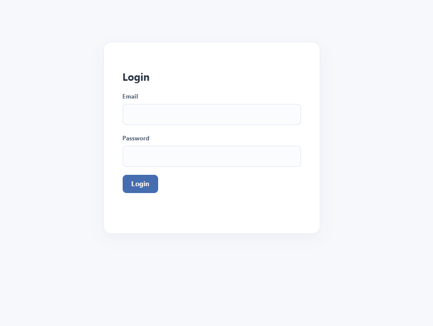
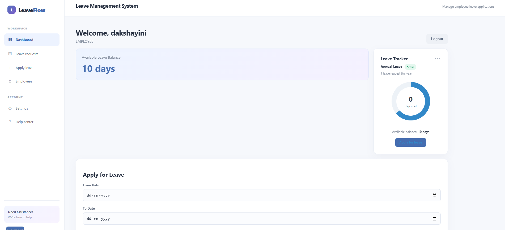
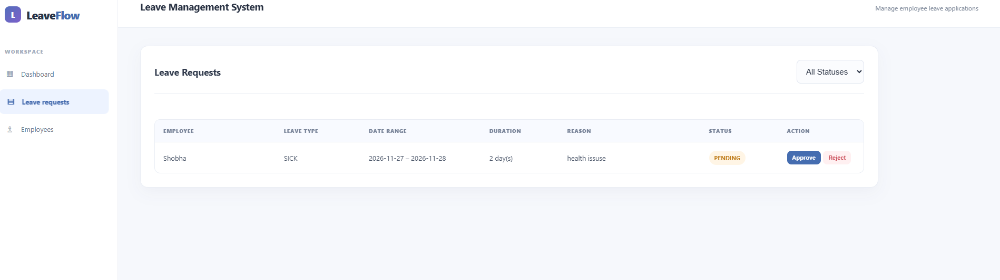
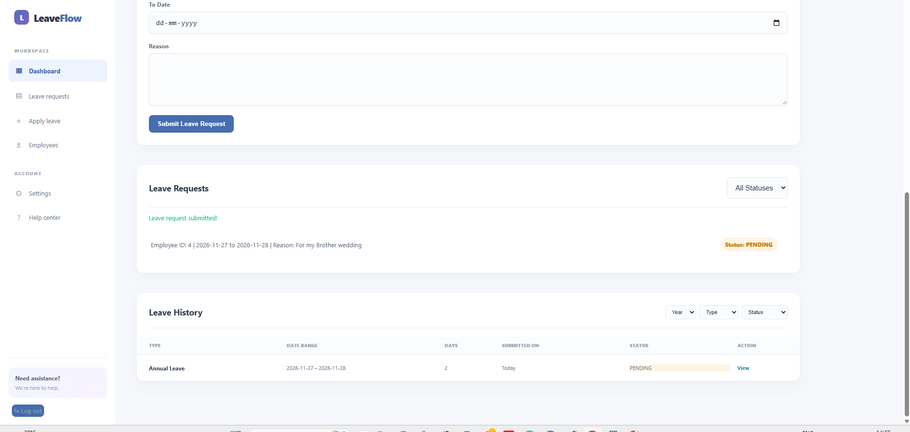

# Leave Management System

A Flask/MySQL leave-management application with a responsive HTML/CSS frontend.

## Run with Docker

From the repository root:

```bash
docker compose up --build
```

Open the frontend at `http://localhost:8080`. The backend health endpoint is `http://localhost:5000/health`.

Tables are created automatically when the backend starts. The first admin account can be created with:

```bash
docker compose exec backend python init_db.py
```

## Local development

Create a virtual environment, install `backend/requirements.txt`, configure the database variables in `.env`, then run:

```powershell
.\venv\Scripts\python.exe backend\run.py
```

## API

All protected endpoints use `Authorization: Bearer <access_token>`.

| Method | Endpoint | Purpose |
|---|---|---|
| POST | `/auth/login` | Log in and receive a JWT |
| POST | `/employees` | Create an employee |
| GET | `/employees` | List employees and balances |
| POST | `/leaves` | Submit a leave request |
| GET | `/leaves?status=PENDING` | List/filter leave requests |
| PUT | `/leaves/{id}/approve` | Approve and deduct balance |
| PUT | `/leaves/{id}/reject` | Reject without changing balance |

Example login:

```json
POST /auth/login
{
  "email": "admin@example.com",
  "password": "a-password-of-at-least-12-chars"
}
```

Example leave request:

```json
POST /leaves
{
  "employee_id": 1,
  "from_date": "2026-06-18",
  "to_date": "2026-06-20",
  "reason": "Personal work"
}
```

Invalid dates and insufficient balance return `400`; missing records return `404`; overlaps and already-processed requests return `409`.

## Tests

```bash
pytest -q
```

The test suite covers invalid dates, insufficient balance, and overlapping approved leave.

## Project structure

- `backend/app/routes` — controller/API routes
- `backend/app/services` — business rules
- `backend/app/repositories` — database access
- `frontend` — browser UI
- `schema.sql` — MySQL schema
- `postman/leave-management.postman_collection.json` — API collection

## Screenshots

### Login screen


### Employee dashboard


### Admin leave requests


### Docker containers

